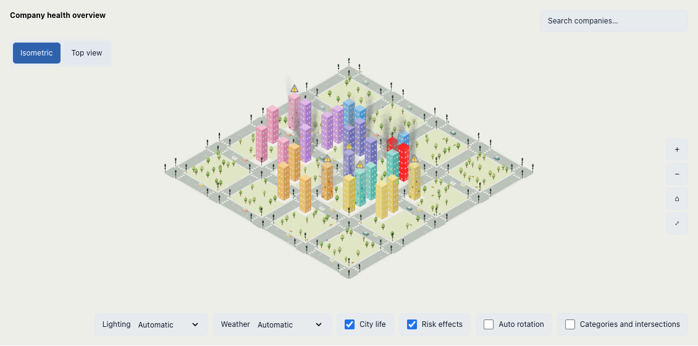

# Atlas CityMap



Atlas CityMap is a reusable React component that turns company data into an interactive 3D city. Embed it in your website or dashboard by passing an array of company records and importing the included CSS. Building size represents a metric such as revenue or users, districts group companies by category, and visual effects highlight health risks—helping people explore a portfolio, spot problems, and inspect individual companies.

Start with the [interactive documentation](https://raphox.github.io/atlas/) or the [package integration guide](packages/city-chart/README.md) for installation, props, events, and styling. The component includes search, selection, camera controls, weather effects, and fullscreen, without requiring the Atlas demo application or Tailwind.

This repository also includes a demo application with 1,400 fictional companies, initially displayed in cities of 100 companies.

## Getting started

A Vite application with React 19, TanStack Charts 1.1.0, Three.js, and Tailwind CSS 4. Requires Node.js 22.12 or later in the 22.x series, or Node.js 24 or later. See [Running Atlas locally](RUN-LOCALLY.md).

```sh
npm ci
npm run dev
```

Open http://127.0.0.1:4173. Vite rebuilds changes automatically. `npm start` also starts the development environment. For production, run `npm run build` and `npm run preview` to inspect the result. Deployment uses only the static files in `dist/`; Three.js is included in the bundle, with no CDN dependency for the scene.

## Interactive documentation

The documentation is published at [raphox.github.io/atlas](https://raphox.github.io/atlas/), with a separate [Features screen](https://raphox.github.io/atlas/?page=features) covering the map, monitoring, and the weather API lifecycle.

Documentation, navigation, and examples are written in English. The embedded map keeps its browser-language behavior. Rain density scales with city area up to 800 drops, so compact examples do not compress a full city's precipitation into a smaller footprint.

```sh
npm run dev:docs      # http://127.0.0.1:4174
npm run build:docs    # static output in dist/docs (default base: /atlas/)
npm run preview:docs # http://127.0.0.1:4174/atlas/
npm run test:docs    # build + production browser tests
```

Content lives in `docs/content/*.mdx`, compiled with `@mdx-js/rollup`. The React Live playground uses the actual shared `CityMap` source, with editable JSX and JSON, explicit execution, reset, copy, and error reporting. It runs locally in the browser and uses simulated weather; it does not request location or call a weather API. Examples live in `docs/examples.js`. Arbitrary imports are not supported; `React`, `CityMap`, and `companies` are supplied in scope. Finish a playground snippet with `render(<Example />)`.

The independent `Tests` workflow runs on pushes to `main` or manual dispatch. It runs unit tests, two browser-test shards, and the documentation build/browser tests. Only a successful `Tests` run on `main` triggers `Documentation → GitHub Pages`, which checks out that exact tested commit, builds `dist/docs`, and deploys it. A failed, cancelled, or skipped prerequisite prevents deployment and leaves the published site unchanged. To deploy manually, run `Tests` on `main`; manual tests on other branches do not deploy. Browser-test logs include individual durations, and result reports and failure traces are retained as workflow artifacts for seven days. Enable **Settings → Pages → Source → GitHub Actions**. The workflow obtains `DOCS_BASE_PATH` from Pages metadata; local builds default to `/atlas/`. Set `DOCS_BASE_PATH=/` for a root/custom-domain deployment. Query-string screens and fragment links work on static hosting without SPA rewrites. The Atlas SPA keeps its existing build and development commands.

## Interface structure

- `src/main.jsx` mounts the React tree; `src/App.jsx` organizes the application.
- `src/components/` contains the header, help, filters, summary, import, search, map, controls, details, and paginated table. Fields, selectors, search suggestions, toggles, and perspective controls use native HTML (`input`, `select`, `datalist`, checkbox, and radio). Cards, buttons, dialogs, and tooltips retain the existing components.
- `src/hooks/use-atlas.js` manages data and shared state between the map and table. The extension in `src/charts/city/` uses `createMark`, `defineChart`, `ChartRenderer`, and the official TanStack `Chart` component. See the [development guide](src/charts/city/README.md) to use the city in another project, configure events, and understand the architecture.
- `src/index.css` configures Tailwind and the shadcn/ui theme tokens; the layout and components use utility classes. The remaining custom CSS supports the canvas and snapshots used in city transitions.
- `components.json` configures shadcn/ui. To add components: `npx shadcn@latest add component-name`. The local `cn` utility is in `src/lib/utils.js`.
- `scripts/generate-demo.mjs` generates `public/data/empresas.json` before startup or builds. `public/config.json` configures the data source.

`npm test` covers data validation, filters, pagination, layout, camera math, localization, weather parsing, particles, lighting, traffic, and resource disposal without launching a browser.

CI runs unit tests once in a dedicated job, in parallel with the Playwright jobs. The unit job skips browser downloads and does not install Chromium or its system dependencies. Only the browser jobs (including documentation checks) install Chromium's headless shell, avoiding the additional full-browser download. Pages deployment still waits for every required job to pass.

The browser suite is deliberately limited to **eight scenarios**: six application/package checks (`npm run test:e2e`) and two documentation checks (`npm run test:docs`). They cover React/map/table integration, native file upload/download, mobile layout/fullscreen, the two distributed CSS themes with independent map instances, the browser geolocation/weather lifecycle, and the editable documentation with mobile navigation. Run `npx playwright install chromium` before the first use. The application tests use a dedicated server on port 4176, prebundle their fixtures, and disable hot reload to prevent a development reload from resetting a test.

Keep new domain rules and animation calculations in unit tests. Add a browser scenario only when the behavior requires browser rendering, DOM integration, or a native browser API; extend an existing scenario when possible. Tests use small deterministic datasets and mocked network responses. Each browser action has a 15-second timeout instead of waiting for the entire test budget.

## Map language

The map interface uses `navigator.language`: `pt-BR` displays Brazilian Portuguese and `en-US` displays American English. Unsupported languages fall back to `en-US`. Translations are in `src/charts/city/i18n.js` and are shared by the application and reusable package. Controls, search, details, tooltips, weather messages, and numbers follow the selected language; names, categories, and metrics supplied in the data are preserved. Localization is limited to the map interface.

## Navigation

- Drag with the left mouse button to rotate horizontally. The tilt stays locked to the default isometric view; dragging up or down does not tilt the map.
- Use the mouse wheel, +/− buttons, or a pinch gesture to zoom.
- Drag with the right mouse button or two fingers to pan.
- Click a building to select its company. The building receives a white outline with a dark border, and the lot receives a contrasting frame. The highlight is reused across selections and preserves category colors and risk effects.
- The table below the map shows companies, categories, metric values, and health. It follows the same filters and pagination as the city. The view-on-map action selects, centers, and zooms in on the corresponding building up to the maximum allowed zoom.
- Use search or filters to find companies. The health filter appears before the summary; category and intersection counts reflect all active filters across the full dataset, before pagination.
- Choose 100, 250, 500, 1,000, or all companies per city; filters are applied before pagination.
- When moving to the next page, the current city slides left and the next city enters from the right, already centered. Moving back reverses the direction. The table follows the page; with reduced motion, the switch is immediate.
- Switch between isometric and top views. Press 0 to restore the overview.
- The **City life** and **Risk effects** controls toggle their respective animations. The system preference for reduced motion is respected.

## Local weather and lighting

With **City life** enabled (the default), the browser requests location permission to query [Open-Meteo](https://open-meteo.com/) and display rain or snow. Automatic weather follows this control. Geolocation requires HTTPS in production; `localhost` is also supported during development. Denying permission or encountering a location/API error keeps the map available, with a status message and no precipitation.

Automatic lighting uses only the browser's local clock: sunrise from 6:00 to 8:00 a.m., day from 8:00 a.m. to 5:00 p.m., sunset from 5:00 to 7:00 p.m., and night from 7:00 p.m. to 6:00 a.m. The selector allows these periods to be chosen manually. Weather does not change the time or time zone used for lighting.

The boolean `showEnvironmentControls` prop defaults to `false` on `CityMap` and `CityChart`, including the reusable package. Add `showEnvironmentControls` without a value to display the **Lighting** and **Weather** dropdowns. The demo in `src/App.jsx` omits it, keeping them hidden. Omit the prop or use `showEnvironmentControls={false}` to hide them:

```jsx
<CityMap atlas={atlas} showEnvironmentControls />
```

The independent selectors allow **Day**, **Sunrise/sunset**, or **Night** to be combined with **No precipitation**, **Rain**, or **Snow**. **Automatic** resumes the local clock and API weather, respectively. The map status identifies manual weather as a simulation. Both selectors are disabled when **City life** is off, preserving choices for when it is enabled again. Hiding the dropdowns returns the scene to the values supplied through props (local time and API weather in the application); automatic requests continue to follow City life.

- Requests are made directly by the client, with no account, API key, or backend in the default mode.
- Atlas requests location without high accuracy and rounds coordinates to two decimal places before sending them. Coordinates and responses remain only in memory during the session; they are not stored in `localStorage`, cookies, or company records. The provider receives the IP address and approximate coordinates, subject to the [Open-Meteo policy](https://open-meteo.com/en/terms).
- Results are reused for 15 minutes. Periodic requests pause while the tab is hidden and resume as needed when it becomes visible. Each request has a 10-second timeout; failures remove precipitation and are retried after 15 minutes. To request location again, re-enable City life.
- Disabling **City life** stops pending requests, periodic refreshes, and particles, restoring daylight as in the existing behavior. Re-enabling it uses the browser's permission and may reuse a still-valid result in memory.
- Three.js particles reuse buffers and do not interfere with company selection. Snow uses small flakes, irregular distribution, and varied speeds; a light, partial layer accumulates on the ground and rooftops over about 24 seconds, without covering all building colors. The layer is removed when leaving snow mode or turning off City life.
- Rain adjusts its contrast to the lighting: darker blue during the day and lighter blue at night. During rain, each lightning event starts with an immediate flash followed by one or two weaker flashes, separated by irregular dark intervals; the first occurs after 12–24 seconds and subsequent events occur every 18–38 seconds of animation, at randomized intervals. There is no sound. With reduced motion, weather is shown as text, while particles, accumulation, and lightning are hidden.
- `weather_code`, `rain`, `showers`, and `snowfall` determine the effect; snow takes priority in mixed precipitation. These are regional estimates, not instant detection on the user's street. Incomplete responses or timestamps more than 90 minutes from the current time are rejected.

### Attribution and commercial use responsibilities

Weather data is provided by **[Open-Meteo](https://open-meteo.com/)** under **[CC BY 4.0](https://creativecommons.org/licenses/by/4.0/)**. Atlas interprets this data as visual effects. Attribution and license links appear in the map footer and must be preserved in distributions that use the data.

This project's code license and the service access terms are independent. Making Atlas open source **does not automatically authorize commercial use of Open-Meteo's free endpoint**. Under the [provider's terms](https://open-meteo.com/en/terms), that endpoint is intended for noncommercial use and has request limits.

**Anyone deploying or operating an instance is responsible for checking and complying with the terms applicable to their use**, including commercial use, attribution, limits, and privacy. For a commercial deployment, the operator must configure a compatible service, such as a commercial subscription through a custom endpoint, a self-hosted instance under its applicable licenses, or another authorized provider. The same rule applies to demos hosted by the maintainer.

The API URL can be replaced at build time:

```sh
VITE_WEATHER_API_URL=https://weather.example.com/v1/forecast npm run build
```

The endpoint must accept the parameters and return the `current` contract from the [Forecast API](https://open-meteo.com/en/docs), including `time` in Unix seconds, and allow CORS for the SPA's origin. The client sends `credentials: omit`. `VITE_*` variables are public in the bundle: **do not include secret commercial keys in the URL or client code**; a custom endpoint should add them on the server when needed. Check the provider's current limits before publishing an instance.

## Data

The sample download button provides JSON in the accepted format:

```json
[
  {
    "id": "my-company",
    "name": "My company",
    "metric": { "label": "Monthly revenue", "value": 1350.75 },
    "categories": [
      { "label": "Retail", "value": "retail" },
      { "label": "Services", "value": "services" }
    ],
    "status": "warning",
    "updatedAt": "2026-10-19T12:00:00-03:00",
    "statusChangedAt": "2026-10-19T11:45:00-03:00"
  }
]
```

`metric.label` is the name displayed in the table, details, and tooltip; `metric.value` is a finite, nonnegative number that determines building size while preserving decimal places. It can represent users, revenue, contracts, or another measure. When labels differ within the same dataset, the table uses a generic value heading and identifies the metric on each row.

`categories` contains one or more `{ "label": "Display name", "value": "identifier" }` pairs. Both `value` and `label` must be nonempty strings, and the same identifier must have the same label throughout the dataset. The map supports up to **three distinct categories per dataset**, with up to seven combinations. Districts, filters, details, and labels use these names. Identifiers are sorted to assign internal bits; assignment happens before filtering and pagination. Each company appears exactly once, at the exact intersection of its categories.

`id` identifies the company and must be unique; if omitted, it is generated during import. `name` is a nonempty string. `status` accepts `healthy`, `warning`, and `critical`. The previous format (`users` and `systems: ["A", "B", "C"]`) is still accepted and converted to metrics and categories. Legacy codes retain their meanings: Leads, Artificial Intelligence, and Real Estate Agencies.

`updatedAt` records the last update to the record. `statusChangedAt` records when the **current status** began: when health changes, update both timestamps; when only the metric or name changes, preserve `statusChangedAt`. If a company leaves high risk and returns, send the timestamp of that new entry. Timestamps use ISO 8601 with a time zone (`Z` or an offset such as `-03:00`); invalid dates or a health change later than the update timestamp are rejected. Both fields are optional for compatibility with older datasets.

The monitoring panel shows a digital clock in the browser's local time zone and up to four companies **currently at high risk**, arranged in two columns of two companies, sorted by `statusChangedAt` from newest to oldest. It uses the entire loaded dataset without filters or pagination and remains visible when controls are hidden and in fullscreen mode. Companies without a status-change timestamp are counted separately, without inventing an entry time; `updatedAt` alone does not establish when a company entered risk. The update column and details show the available timestamps. The panel reflects the last load/import; it does not add periodic data source requests.

Imports accept a JSON list up to 5 MB, run in the browser, and do not persist after a reload. An invalid import preserves the previous city.

Each page generates an independent city. The territory is calculated from the number of companies in each category combination, using three overlapping rectangles on the grid. Lots nearest the center are occupied first within each region. Regions represent each category and its intersections; their names come from the data. All streets intersect at 90 degrees on the ground plane. Parks are reserved before allocation. Regions grow according to the number of companies on the page. The all-companies option combines filtered results into a single city. The initial setting is 100 companies per city, with alternatives of 250, 500, and 1,000. This version does not automatically refresh company data.

## SPA and future backend

The application is a React SPA built with Vite. The server delivers HTML, CSS, JavaScript, and JSON; all transformation of company records into a city happens in the browser. There is no SSR or backend dependency for generating geometry in the SPA.

The source is declared in `public/config.json` (copied to `/config.json`):

```json
{"dataUrl":"/data/empresas.json","mode":"demo"}
```

The build generates demo JSON with 1,400 records. To use a backend, change `dataUrl` to your endpoint and `mode` to `live`. The endpoint must return a list in the format documented above or an object shaped as `{ "companies": [...] }`. It does not need to send positions, geometry, blocks, or Three.js information. The SPA validates the JSON, filters the full dataset, paginates, calculates intersections, allocates lots, and builds the scene.

`src/data-source.js` handles HTTP loading and data contract conversion. On the same domain, session cookies use `credentials: same-origin`. An endpoint on another domain must allow CORS; authentication for that backend has not yet been implemented. Loading errors are displayed and are not silently replaced with fictional data. Data loads when the application opens; automatic refresh has not yet been implemented.

## Rendering

The city uses simplified geometry: one block per building, planar windows/streets/sidewalks, cars without wheels, pedestrians without legs, and eight-sided tree canopies/heads and fire/smoke volumes. The lawn is a green plane, sidewalks are gray planes, and building lots are light-colored planes. There are no window frames, extra roofs, foundations, or grass blocks. Sparse benches use a single low block and share the tree trunk instance batch. Base geometry dropped from 96,830 to 26,022 triangles with 100 companies and from 804,354 to 198,042 with 1,400; `node scripts/benchmark-city.mjs` reproduces the measurement without effects. Lit materials use flat shading. Window emissions retain their motion and remain constrained to the opening.

Every unoccupied lot in the displayed city receives green ground, distributed between clearings and groups of up to three trees, including reserved parks and free lots within the seven regions. About 9% of lots receive a bench, in varied orientations and with free space around it. Vegetation is recalculated after filtering, pagination, and imports, without occupying streets or company lots. Counts, colors, sizes, and positions vary deterministically by coordinate; canopies remain within gardens. The same geometries are reused through instancing.

Buildings, windows, vegetation, vehicles, and pedestrians use `InstancedMesh`. Traffic is simulated in `src/traffic.js`, with directional lanes, turn curves, acceleration, braking, and minimum vehicle spacing. Intersections connect all four road approaches and include sidewalks, crosswalks, stop lines, and traffic lights. Each intersection reserves its area for one vehicle at a time and has a dedicated pedestrian crossing phase, releasing it only after cars and pedestrians have cleared it. Vehicle and pedestrian counts scale with city blocks, capped at 36 cars and 60 pedestrians.

Flames and smoke are instanced 3D volumes, defined in `src/plumes.js` and rendered in `src/plume-renderer.js`. Each emitter corresponds to an actual window in the geometry. Particles originate behind the facade, fit within the opening, and move outward along the wall normal; expansion begins outside. Flow depends on window area. Motion approximates exit pressure, drag, buoyancy, turbulence, and cooling; it is not a CFD simulation. Depth testing hides sources inside the building. Medium risk produces only light smoke and a warning, while high risk adds flames and a glow inside windows. Company color always identifies categories, never risk.

The size model is in `src/model.js` (`sizeForValue`) and uses four illustrative value ranges: below 90, 90 to below 550, 550 to below 1,800, and 1,800 or above. Changing the label does not change these thresholds; the scale remains the same for any metric. The initial assessment is fictional: effects represent the supplied status without calculating actual risk.

At medium risk, houses emit smoke through one window; small, medium, and large buildings use two, three, and five windows, respectively, spread across floors and facades. Smoke remains light, without flames; high risk retains fire and dark smoke.

Critical buildings also flash red, switching instantly between red and their original category color. Each company has its own sequence of pseudorandom intervals between 450 and 1,100 ms, with an offset start and no gradual transition. All faces of the block share the same rhythm; the sequence remains stable per company when filters or pages change. The **Risk effects** control disables flashing and restores the original colors. With reduced motion, the red highlight is static.

## Formatting

The project uses Biome, configured in `biome.json`, with support for Tailwind CSS 4 directives. Run `npm run format` to format files or `npm run format:check` to check without making changes. Generated files, dependencies, and the lockfile are excluded from formatting.

## Verification

`npm test` checks membership in the seven regions, unique lots, no occupation of streets/parks, filtering before pagination, all page-size options, growth by region, and import validation. Traffic tests simulate multiple cycles in different cities to check for vehicle collisions, pedestrian collisions, phase separation, and continuous movement. Emission tests verify internal origins, opening constraints, external expansion, and Three.js volume integrity. `npm run build` generates the bundle. The scene requires WebGL. Browser tests use software rendering; performance measurements on real hardware are still necessary.

`window.atlas.summary` exposes company counts and rendering statistics to support integration.

Map labels display category names, including combinations at intersections.

Navigation keeps only one WebGL city active and, during a slide transition, a temporary 2D snapshot of the previous city. Geometry, materials, textures, and instance buffers from the old city are disposed of before the next mount. When the animation ends or is canceled, the snapshot is removed and its bitmap is cleared. The animated loading indicator appears before preparation; repeated clicks are blocked, and filter changes cancel pending requests.

The medium-risk warning uses a bright yellow triangle, a dark exclamation mark and outline, and a white outer border, with an enlarged size and a color independent of scene tone mapping.

The extension shares its layout between the TanStack mark and the 3D renderer. Palette changes reuse geometry; metric or health changes preserve terrain, traffic, and camera when lots remain unchanged. With animations disabled and the camera settled, the scene renders on demand. Contracts and update rules are documented in [src/charts/city/README.md](src/charts/city/README.md).

## Reusable npm package

The complete chart can be distributed as `atlas-city-chart`, separately from the SPA:

```sh
npm run pack:package
```

The command generates `atlas-city-chart-0.1.0.tgz`, which can be installed in another project with `npm install /path/to/atlas-city-chart-0.1.0.tgz`. Import `CityMap` from `atlas-city-chart/react` and `atlas-city-chart/styles.css`. The component includes the map, weather, lighting, search, and buttons; it receives `data` directly. Plain CSS (`theme="default"`) and Tailwind 4 (`theme="tailwind"`) themes provide public classes and CSS tokens for customization. The engine API is available through the `atlas-city-chart` entry point.

See the [package guide](packages/city-chart/README.md) for installation, examples, themes, props, tests, and publishing. The package is prepared for local distribution; it has not yet been published to the npm registry.
